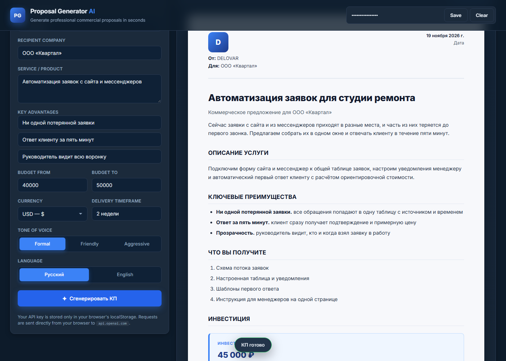
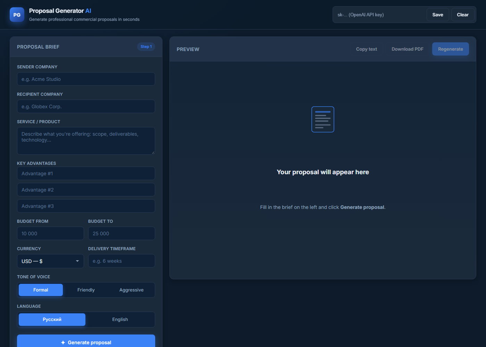

# Генератор коммерческих предложений

Веб-приложение, которое по короткому брифу пишет готовое коммерческое предложение и выгружает его в PDF. Текст пишет модель OpenAI `gpt-4o-mini`, всё остальное работает прямо в браузере: без сервера, без сборки, без фреймворков.



## Что умеет

- бриф слева, готовый документ справа
- документ целиком: вступление, описание услуги, преимущества, что получит клиент, цена, сроки, призыв к действию и подпись
- русский и английский, три тона: официальный, дружелюбный, продающий
- выгрузка в PDF на несколько страниц А4 (кириллица не ломается), копирование текстом, кнопка «сгенерировать заново»
- ключ, последний бриф и последнее предложение сохраняются в браузере

## Как запустить

1. Нужен ключ OpenAI: <https://platform.openai.com/api-keys>. Одно предложение на `gpt-4o-mini` стоит доли цента.
2. Откройте папку через любой локальный сервер. Просто открыть `index.html` двойным кликом не получится: браузер не пустит запрос к API со страницы `file://`.

```bash
python -m http.server 5173
# или
npx serve .
```

3. Откройте <http://localhost:5173>, вставьте ключ справа сверху, заполните бриф и нажмите «Сгенерировать».



## Как устроен промпт

`generator.js` отправляет в `chat/completions` два сообщения. Системное задаёт роль B2B-копирайтера и запрещает пустые фразы вроде «рады предложить сотрудничество». Пользовательское передаёт поля брифа и строгую JSON-схему: заголовок, подзаголовок, вступление, описание, преимущества, результаты, цена, сроки, призыв, подпись. Ответ приходит в режиме `json_object`, приложение проверяет его, приводит к схеме и рисует документ.

Параметры: `gpt-4o-mini`, `temperature 0.75`, `top_p 0.95`.

## Файлы

```
index.html     разметка и подключение скриптов
style.css      тёмная тема интерфейса и вёрстка документа
app.js         состояние, форма, отрисовка, кнопки
generator.js   промпт и запрос к OpenAI
pdf-export.js  выгрузка в PDF через html2canvas и jsPDF
docs/          скриншоты для README
```

## Важно про ключ

Ключ хранится только в `localStorage` этого браузера и уходит напрямую на `api.openai.com`. Но любой, у кого есть доступ к этому компьютеру и инструментам разработчика, его увидит. Для продакшена запросы лучше пускать через свой сервер, а на общем компьютере нажимать «Clear» после работы.

## Ограничения

- интерфейс рассчитан на экран от 1080 px, на телефоне панели встают друг под другом
- jsPDF и html2canvas грузятся с CDN, поэтому первый PDF на медленном интернете собирается не сразу

## Автор

Степан Павленко (DELOVAR). Делаю сайты, ботов и автоматизацию для малого бизнеса.

Лицензия MIT.
